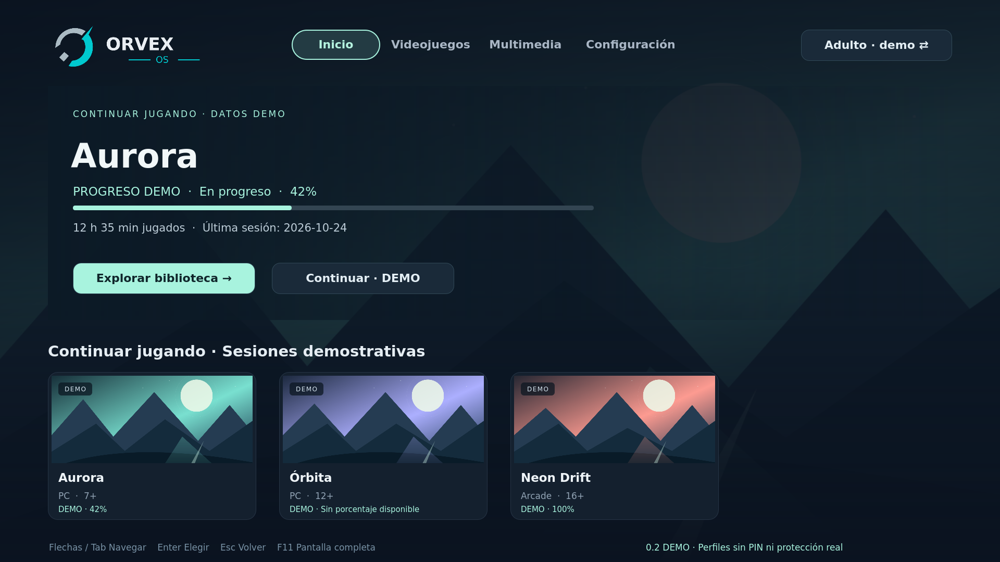

# ORVEX OS 0.2 · Visual Preview

Sistema operativo de entretenimiento basado en Linux, orientado a videojuegos y multimedia. Esta entrega es un launcher y una vista previa interactiva: todavía no es una distribución Linux instalable.



**Actualización visual para revisión:** fondos dinámicos, fijos o predeterminados y seguimiento demostrativo de juegos en Inicio/fichas. Configuración → Interfaz permite elegir el fondo. Hay un caso sin porcentaje disponible; no se asume que todas las plataformas lo entreguen. Ver [alcance, arquitectura y pruebas de esta mejora](docs/VISUAL_PROGRESS_0.2.md).

## Abrir en Windows sin instalar nada

1. Descarga `preview/ORVEX-0.2.html` de esta rama (botón Download raw file de GitHub).
2. Abre el archivo descargado con Edge o Chrome. No requiere servidor, conexión ni Linux.
3. Usa mouse, Tab, flechas y Enter. Esc cierra el aviso de demostración, vuelve de una ficha o regresa a Inicio. F11 activa pantalla completa.

El archivo incluye catálogo, portadas, logotipo, estilos y scripts. No descarga recursos externos. Los favoritos y preferencias de la vista HTML se guardan en el almacenamiento del navegador. Si el navegador bloquea el guardado, se informa en pantalla y la sesión sigue funcionando. La persistencia de archivos `file://` puede depender del navegador, de su política y de conservar la misma ruta del archivo.

La vista 0.1 se conserva en `preview/ORVEX-0.1.html` como referencia histórica.

## Qué funciona

| Función | Qt/QML | HTML autónomo |
|---|---|---|
| Inicio, videojuegos, multimedia y configuración | Sí | Sí |
| Búsqueda por nombre, sin distinguir acentos/mayúsculas | Sí | Sí |
| Plataforma de juegos / tipo de contenido multimedia | Sí | Sí |
| Favoritos independientes por perfil | SQLite | Almacenamiento del navegador |
| Fichas con portada, descripción, edad y disponibilidad | Sí | Sí |
| Volver conservando búsqueda, filtros y selección | Sí | Sí |
| Perfiles Adulto / Infantil y recomendaciones filtradas | Sí | Sí |
| Ajuste de movimiento reducido y perfil persistente | SQLite | Almacenamiento del navegador |
| Seis categorías de configuración y estados futuros | Sí | Sí |

Catálogo ficticio de ocho títulos: cuatro videojuegos y cuatro contenidos multimedia. El botón **Jugar · DEMO / Ver · DEMO** solo muestra un aviso. No lanza procesos ni reproduce contenido.

Infantil permite exclusivamente clasificación General o 7+; clasificaciones ausentes o inválidas se ocultan. Filtra títulos, portadas, resultados, opciones de filtro y recomendaciones. **Los perfiles son demostrativos, sin PIN ni autenticación: no constituyen un control parental seguro.** El catálogo sigue incluido en el código de la demostración.

## Aplicación Qt en Windows

Requiere Python de 64 bits, versión 3.11 o superior. Ejecuta `setup-windows.cmd` una vez y después `run-windows.cmd`. La instalación descarga PySide6 a un entorno aislado. No existe un EXE empaquetado en esta entrega. No se ha ejecutado en Windows físico.

## Aplicación Qt en Linux

```sh
python3 -m venv .venv
.venv/bin/python -m pip install -r requirements.txt
PYTHONPATH=src .venv/bin/python -m orvex
```

También se puede instalar con `python -m pip install .` y ejecutar `orvex-preview`. Linux requiere las bibliotecas gráficas de Qt apropiadas para su escritorio. Se conserva la ubicación de preferencias de 0.1 y se migra SQLite de manera aditiva a esquema 2.

## Desarrollo y pruebas

```sh
python scripts/build_web_preview.py
QT_QPA_PLATFORM=offscreen QT_QUICK_BACKEND=software PYTHONPATH=src .venv/bin/python -m unittest discover -s tests -v
node --test tests/test_web_model.cjs
```

Pruebas de navegador (dependencia de desarrollo opcional):

```sh
npm install
npx playwright install chromium
node tests/test_web_browser.cjs
```

El harness también admite un host local QtWebEngine mediante `ORVEX_WEBENGINE_PYTHON`; ver `docs/ORVEX_0.2_VALIDATION.md`. Ninguna dependencia de Node es necesaria para abrir el HTML o ejecutar la aplicación Qt. El workflow de GitHub se inicia manualmente; no se ejecuta al subir código.

## Estado y límites

Se ejecutaron pruebas automáticas de Python/Qt, del modelo JavaScript y del HTML en Chromium de QtWebEngine bajo Linux. Se generaron capturas 1080p y 4K. Pendientes: Windows/Edge/Chrome y TV físicos, escalado DPI real, GPU y rendimiento en hardware objetivo.

No hay detección de juegos, emuladores, streaming, DRM, Bluetooth, mandos físicos, audio real ni protección parental. La identidad provisional ORVEX OS se conserva sin rediseño.

- [Alcance](docs/ORVEX_0.2_SCOPE.md)
- [Implementado, demostrativo y pendiente](docs/ORVEX_0.2_STATUS.md)
- [Arquitectura](docs/ARCHITECTURE.md)
- [Pruebas y limitaciones](docs/ORVEX_0.2_VALIDATION.md)
- [Prueba guiada desde Windows](docs/WINDOWS_PREVIEW_CHECKLIST.md)

Repositorio privado: https://github.com/pablete260283/Orvex-OS . Cambios únicamente en `feature/orvex-0.2`; no fusionar sin aprobación del usuario. Nombre histórico: JARVIS Entertainment OS.
