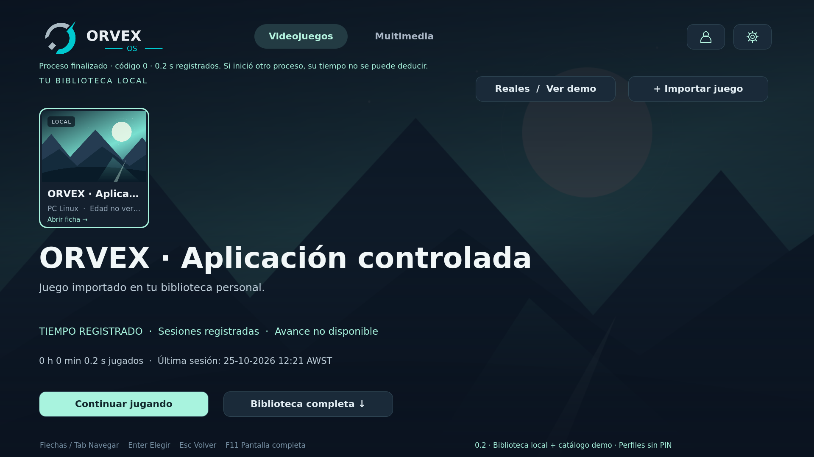

# ORVEX OS 0.2 · Consola y biblioteca local

Launcher de entretenimiento con Qt 6/QML, PySide6 y SQLite. Esta etapa incorpora importación y ejecución de aplicaciones nativas reales; todavía no es una distribución Linux instalable ni garantiza compatibilidad con cualquier juego comercial.



## Probar el lanzamiento real

**Windows:** descarga el repositorio desde la rama `feature/orvex-real-launch` (Code → Download ZIP), extrae todos los archivos y ejecuta `setup-windows.cmd` una vez con Python 3.11+ de 64 bits instalado. Después abre `run-windows.cmd`. La preparación descarga PySide6 a un entorno aislado; no hay un EXE autónomo empaquetado. Windows está implementado pero pendiente de validación física.

**Linux:**

```sh
python3 -m venv .venv
.venv/bin/python -m pip install -r requirements.txt
PYTHONPATH=src .venv/bin/python -m orvex
```

1. Videojuegos abre la biblioteca **real**, inicialmente vacía. `+ Importar juego` permite indicar nombre, plataforma y ruta absoluta, o examinar archivos.
2. Se aceptan ejecutables nativos: `.exe` Windows o ELF Linux con permiso de ejecución. No se admiten scripts, `.bat`, accesos directos, argumentos ni ejecución mediante shell en esta fase. Los juegos de otras plataformas necesitarán adaptadores posteriores.
3. Guardar registra la referencia en SQLite, **sin ejecutar**. Selecciona el juego y pulsa Continuar jugando o abre su ficha y pulsa Jugar.
4. El primer lanzamiento muestra nombre y ruta para confirmar. Si cambia el contenido del archivo, se vuelve a pedir confirmación. La validación no certifica que el ejecutable sea seguro; usa únicamente archivos conocidos y confiables.
5. Al terminar el proceso directo se registran duración, última ejecución y resultado. El tiempo observado no se convierte en porcentaje de campaña. Un launcher que delega en otro proceso puede finalizar antes que el juego.
6. En la ficha, Asociar carátula/fondo permite elegir PNG/JPG/WebP locales, revisarlos y confirmar antes de aplicar/reemplazar. Se copian a la caché personal, nunca al repositorio.

El catálogo demo se consulta mediante `Reales / Ver demo`, completamente separado del inventario instalado. Infantil oculta todos los juegos importados porque aún no tienen edad verificada. Los perfiles siguen siendo demostrativos, sin PIN; no son control parental seguro.

## Vista visual sin instalar

Descarga `preview/ORVEX-0.2.html` (Download raw file) y ábrelo directamente en Edge o Chrome. Incluye recursos, logo, catálogo ficticio y scripts; no requiere servidor, Linux ni red. **El HTML no puede importar ni lanzar juegos locales**. Sus acciones son demostrativas y no deben confundirse con la aplicación Qt.

La cabecera tiene solo Videojuegos/Multimedia, menú de perfil y engranaje. Carrusel contextual arriba, biblioteca con búsqueda/filtros abajo. Mouse, flechas, Tab y Enter; Escape vuelve, F11 cambia pantalla completa. Los adaptadores de mandos físicos siguen pendientes. Fondos con precarga/fundido y movimiento reducido. Las barras solo se muestran si una fuente verifica el porcentaje; no hay tal integración real en esta entrega.

## Persistencia y compatibilidad

SQLite conserva preferencias/favoritos de 0.1/0.2 y añade `real_games` y `play_sessions` mediante migración aditiva a esquema 3. Se conserva la ruta histórica `Entertainment Preview` para no perder datos; el nombre visible sigue siendo ORVEX OS. No se modifican los ejecutables importados. Solo una instancia Qt por usuario. Mientras hay un proceso supervisado, cierra el juego antes de salir de ORVEX. Si el host termina abruptamente, la sesión se marca interrumpida al reiniciar, sin inventar duración.

Multimedia, búsqueda, filtros, favoritos, fichas y ajustes continúan disponibles. No hay streaming, emuladores, ROMs, BIOS, DRM, reproducción multimedia ni proveedores de metadatos conectados. Logo provisional conservado.

## Pruebas y resultados

```sh
python scripts/build_web_preview.py
QT_QPA_PLATFORM=offscreen QT_QUICK_BACKEND=software PYTHONPATH=src .venv/bin/python -m unittest discover -s tests -v
node --test tests/test_web_model.cjs
```

Pruebas de navegador: `npm install`, `npx playwright install chromium`, `node tests/test_web_browser.cjs` (solo desarrollo). El harness también acepta QtWebEngine mediante `ORVEX_WEBENGINE_PYTHON`. Node no es dependencia del producto.

**61 comprobaciones aprobadas:** 41 Python/Qt, 7 Node y 13 recorridos de navegador. Lanzamiento real de una aplicación C propia, compilada temporalmente en Linux, incluido recorrido por la UI. Capturas Qt/HTML en 1080p/4K y logs en `docs/validation/real-launch-*.txt`. Pendientes Windows nativo, TV/DPI/GPU físicos, juegos comerciales y mandos.

- [Entrega, decisiones, validación y límites](docs/REAL_LAUNCH.md)
- [Prueba guiada Windows/Linux](docs/REAL_LAUNCH_CHECKLIST.md)
- [Arquitectura](docs/ARCHITECTURE.md)
- [Procedencia y proveedores gráficos](docs/ARTWORK_PROVIDERS.md)

Rama nueva `feature/orvex-real-launch`; PR independiente basado en `main` aprobado. El PR #3 permanece pendiente; no se fusiona ningún PR sin aprobación. Repositorio privado: https://github.com/pablete260283/Orvex-OS . Nombre histórico: JARVIS Entertainment OS.
