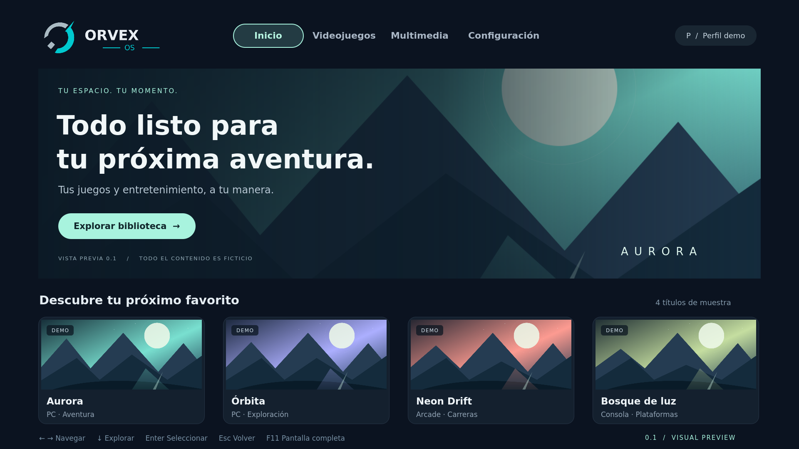

# ORVEX OS · 0.1 Visual Preview

Primera entrega visual ejecutable. Aplicación principal: Qt 6/QML + PySide6; preferencias: SQLite. Todos los títulos, plataformas y portadas son ficticios. No se incluyen juegos, BIOS, ROMs ni servicios de streaming.



## Revisar sin instalar nada

Abre `preview/ORVEX-0.1.html` con Chrome o Edge. Es una representación HTML autónoma para revisar las cuatro pantallas, no la aplicación Qt ejecutada en el navegador. Funciona sin conexión y no descarga recursos. Las preferencias de esta vista usan almacenamiento del navegador, separado de SQLite. Si está bloqueado, el ajuste solo dura la sesión.

Flechas izquierda/derecha cambian de sección; abajo entra al contenido; arriba vuelve al menú; Enter selecciona; Esc cierra el aviso o vuelve a Inicio. También funciona con mouse y Tab. F11 activa pantalla completa en el navegador.

## Aplicación Qt en Windows

Requiere Python 3.11 o superior de 64 bits. No requiere Linux ni Qt Creator.

1. Ejecuta `setup-windows.cmd` para crear un entorno aislado y descargar PySide6. Este paso requiere conexión y ocupa varios cientos de MB.
2. Ejecuta `run-windows.cmd`.

No hay un EXE empaquetado en esta entrega. No se ha probado en un equipo Windows físico.

## Aplicación Qt en Linux/macOS

```sh
python3 -m venv .venv
.venv/bin/python -m pip install -r requirements.txt
PYTHONPATH=src .venv/bin/python -m orvex
```

También se puede instalar como paquete con `python -m pip install .` y ejecutar `orvex-preview`. En Linux el escritorio debe tener las bibliotecas gráficas requeridas por Qt. El lanzador no modifica ajustes del sistema. La preferencia SQLite se guarda en la ubicación de datos de usuario que informa Qt.

## Pruebas

```sh
QT_QPA_PLATFORM=offscreen QT_QUICK_BACKEND=software PYTHONPATH=src .venv/bin/python -m unittest discover -s tests -v
```

Las pruebas generan capturas nativas de todas las pantallas en 1920×1080 y 3840×2160 dentro de `preview/`. En Windows, establece esas variables de entorno antes de ejecutar `python -m unittest discover -s tests -v`.

## Estado

- Implementado: cuatro pantallas navegables, foco visual, teclado/mouse, ventana y pantalla completa, escalado proporcional con márgenes en otras relaciones de aspecto, avisos de demostración y persistencia SQLite del ajuste reducir movimiento.
- Demostrativo: catálogo JSON de seis títulos, carátulas SVG originales, perfil y las categorías de plataforma. No representan instalaciones, disponibilidad ni compatibilidad reales.
- Pendiente: emulación, reproducción, mandos reales, Bluetooth, DRM, perfiles y control parental, importación de bibliotecas, métricas de rendimiento y distribución Linux.
- La preferencia reducir movimiento persiste; esta versión no utiliza animaciones, por lo que no cambia la apariencia actual.
- GitHub: https://github.com/pablete260283/Orvex-OS (privado). Se conserva el historial inicial del repositorio. El workflow queda preparado; consulta GitHub Actions para su estado.

Consulta `docs/ARCHITECTURE.md`, `docs/VALIDATION.md` y `docs/ROADMAP.md`.

## Nombre del proyecto

ORVEX OS es el nombre de trabajo actual del proyecto antes denominado JARVIS Entertainment OS. Se mantienen sus objetivos y requisitos. Open-source gaming and entertainment operating system based on Linux.
